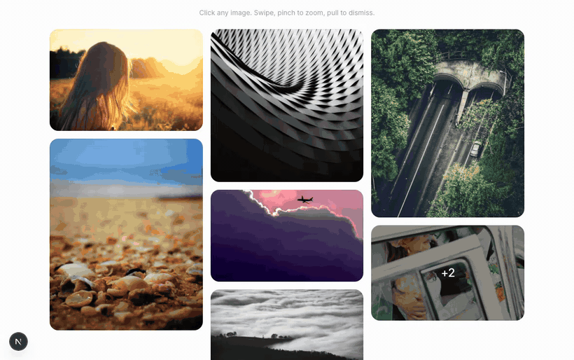

# ramka

**The lightbox for React.** Unstyled, accessible gallery primitives in the style of Radix UI and Base UI, with shared-element View Transitions, native scroll swiping, pinch to zoom, and pull to dismiss.

[ramka.dev](https://ramka.dev) · [Documentation](https://ramka.dev/docs) · [Examples](https://ramka.dev/examples/lightbox/photos-app) · [Pricing & license](https://ramka.dev/license)



> _ramka_ — Polish for "frame".

## Highlights

- **Morph view transitions.** Shared-element View Transitions morph anything into the lightbox and back: images, video, plain HTML. Browsers without the API get a clean crossfade.
- **Native scrolling.** Slides ride real CSS scroll snapping, not a transform-emulated carousel. Swiping feels native because it is.
- **Pinch to zoom.** Pinch on touch or trackpad, double-tap to zoom, ctrl + scroll to zoom at the cursor. Pan with a finger, mouse, or arrow keys.
- **Pull to dismiss.** Drag down on touch or wheel on a trackpad to close, like every photos app. Elastic, interruptible, and aware of zoom and in-flight swipes.
- **Headless and unstyled.** Composable primitives with the API you know from Radix UI and Base UI: Trigger, Slides, Zoom, Captions, Thumbnails, Counter. You own every pixel.
- **Accessible by default.** A focus-trapped dialog with full keyboard navigation, screen-reader naming hooks, and `prefers-reduced-motion` respected.
- **Typed and tiny.** Fully typed, tree-shakeable, zero runtime dependencies. The zoom, morph, and pull engines lazy-load on demand, so a full gallery ships around 19 KB gzipped up front.
- **Images, video, anything.** Photos, videos, 3D models, or any React content. Responsive `srcset` images, first-class `next/image` support, and RTL built in.

## Quick start

```bash
npm install @ramka/react
```

```tsx
import * as Lightbox from '@ramka/react/lightbox';

<Lightbox.Root>
  {items.map((item, i) => (
    <Lightbox.Trigger key={item.id} index={i}>
      {({ imageRef }) => }
    </Lightbox.Trigger>
  ))}

  <Lightbox.Portal>
    <Lightbox.Backdrop />
    <Lightbox.Content aria-label="Photo viewer">
      <Lightbox.Slides aria-label="Photos">
        {items.map((item, i) => (
          <Lightbox.Slide key={item.id}>
            <Lightbox.Item index={i} caption={item.caption}>
              <Lightbox.Zoom>
                <Lightbox.Media>
                  
                </Lightbox.Media>
              </Lightbox.Zoom>
            </Lightbox.Item>
          </Lightbox.Slide>
        ))}
      </Lightbox.Slides>
      <Lightbox.Close aria-label="Close" />
    </Lightbox.Content>
  </Lightbox.Portal>
</Lightbox.Root>;
```

Every part is unstyled: bring your own CSS, or start from a copy-paste [preset](https://ramka.dev/presets/default). The full walkthrough is at [ramka.dev/docs](https://ramka.dev/docs).

## Documentation

- [Installation](https://ramka.dev/docs)
- [Lightbox overview](https://ramka.dev/docs/lightbox)
- [Morph view transitions](https://ramka.dev/docs/lightbox/view-transitions)
- [Gestures and pull to dismiss](https://ramka.dev/docs/lightbox/gestures)
- [Pinch to zoom and accessibility](https://ramka.dev/docs/lightbox/zoom)
- [API reference](https://ramka.dev/docs/lightbox/api)

Package-level details (tree-shaking, CSP, supply chain, localization) live in the [`@ramka/react` README](./packages/ramka/README.md).

## Development

This repository is a pnpm + Turborepo monorepo containing:

- **[`packages/ramka`](./packages/ramka)** — the publishable component library (`@ramka/react`).
- **[`apps/docs`](./apps/docs)** — the Next.js documentation site, styled with Tailwind CSS.

Prerequisites: Node.js >= 18 (developed against Node 22 — see [`.nvmrc`](./.nvmrc)) and [pnpm](https://pnpm.io) 9.

```bash
pnpm install
pnpm dev
```

`pnpm dev` runs the library in watch mode and the docs site (`http://localhost:3000`) in parallel via Turborepo.

| Command          | Description                                            |
| ---------------- | ------------------------------------------------------ |
| `pnpm dev`       | Run the library watcher and the docs site in parallel. |
| `pnpm build`     | Build the library, then the docs site.                 |
| `pnpm lint`      | Lint every workspace.                                  |
| `pnpm typecheck` | Type-check every workspace.                            |
| `pnpm format`    | Format the repo with Prettier.                         |
| `pnpm clean`     | Remove build artifacts and `node_modules`.             |

## License

Dual-licensed: [GPL-3.0-only](./LICENSE), or a [commercial license](https://ramka.dev/license) you may
purchase if you are building proprietary software and do not want to rely on the
GPL. The header of [LICENSE](./LICENSE) is the overview, and
[COMMERCIAL-LICENSE.md](./packages/ramka/COMMERCIAL-LICENSE.md) is the
commercial agreement.
